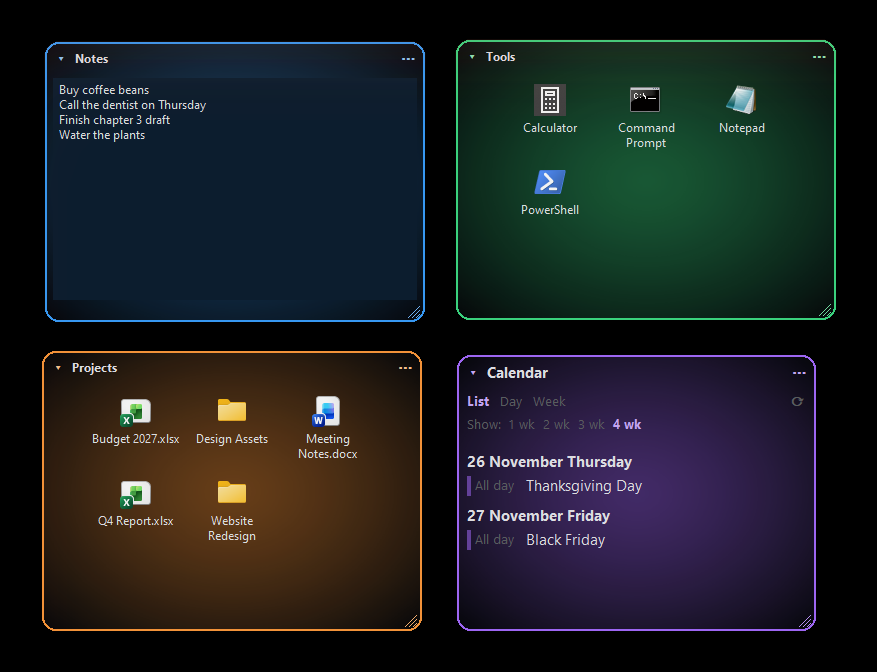

# M Panels

Colorful, tidy desktop panels for Windows, in the spirit of Fences: shortcut panels, note panels and calendar panels that sit on your desktop. Python + tkinter, one process, one tray icon.



## Features

- **Shortcut panels:** each panel is a real (hidden) folder, `<Desktop>\Paneller\<panel name>`. Drag files, folders and shortcuts onto a panel; whatever you add or remove in Explorer shows up in the panel too.
- **Note panels:** type directly in the panel, with Bold, Italic, Underline, color, font and size. Saved automatically.
- **Calendar panels:** your Google or Outlook.com calendars as a List (1-4 weeks), Day or Week view, read through secret iCal addresses (no sign-in, no OAuth).
- Colors, opacity, title and content text styles, snapping panels into stacks, several monitors, lock, collapse, "Start with Windows", tray icon.
- **No permanent deletion.** The program has no delete command: removed panels give their items back to the desktop, removed notes go to a recycle folder.

## Requirements

- Windows 10 or 11
- Python 3.12 (python.org or Anaconda; tkinter must be included, which is the default)

## Installation

```
git clone https://github.com/m-apps-dev/m-panels.git M-Panels
cd M-Panels
python -m venv venv
venv\Scripts\pip install -r requirements.txt
venv\Scripts\python kur.py --write-bat --skip-pip
```

`kur.py --write-bat` writes `M-Panels.bat` and `M-Panels-Test.bat`, which start the program with the `pythonw.exe` of the Python that ran `kur.py` (no console window). Start M Panels with `M-Panels.bat`.

To also create a "Start with Windows" shortcut and a desktop shortcut:

```
venv\Scripts\python kur.py --shortcuts --skip-pip
```

`--skip-pip` matters: without it `kur.py` upgrades the packages instead of keeping the versions pinned in `requirements.txt`. The shortcuts target `pythonw.exe` directly. On first run the hidden `Paneller` folder and a "General" panel are created. Nothing in your Startup or Desktop folder is touched unless you pass `--shortcuts`.

To try it without touching your real desktop, use `M-Panels-Test.bat` (see "Test mode" below).

## Using it

- **Header:** drag = move, arrow or double-click = collapse/expand, the menu button = menu. Resize from the bottom-right corner.
- **Items:** double-click opens, right-click gives Open / Open file location / Rename / Return to desktop. Drag items to reorder them or to move them to another panel.
- **Tray icon:** Show / Hide, New panel, Settings, Quit. `pythonw mpanels.py --quit` asks the running copy to quit.
- **Single instance:** starting M Panels while it runs just shows its panels and brings Settings to the front.
- **Settings** (tabs: Panel, Title, Content, Calendar for calendar panels, General, About): name, color, opacity, start collapsed, open on hover, text styles, icon size, Start with Windows, Lock panels, Hide desktop icons, snapping. Nothing changes until you press Apply; closing with unapplied changes asks Apply / Discard / Cancel.
- **Hide desktop icons** changes Explorer's "Show desktop icons" setting and restores it when M Panels quits. After a crash: `python mpanels.py --restore-desktop-icons`.

### Dragging items in

| Source | Result |
|---|---|
| Your desktop | moved into the panel folder |
| Outside the desktop (for example `D:\Projects`) | not moved; a `.lnk` shortcut is created in the panel |
| The shared "Public" desktop (`%PUBLIC%\Desktop`) | a shortcut copy is created, the original stays |
| A different drive | not moved; a shortcut is created |
| From one panel to another | moved |
| Name clash | ` (2)` is appended to the newcomer; nothing is overwritten |
| Locked or open file | not forced; a short warning |

## Calendar panels

Choose "Calendar" in the New panel window. Calendars are read from **secret iCal addresses**; M Panels never asks for your Google or Microsoft password.

**Get the address**

- **Google Calendar:** open Google Calendar in a browser > Settings > pick the calendar under "Settings for my calendars" > "Integrate calendar" > copy "Secret address in iCal format".
- **Outlook.com:** open Outlook on the web > Settings > Calendar > Shared calendars > "Publish a calendar" > choose the calendar and "Can view all details" > Publish > copy the ICS link.

(The menu names change from time to time; look for "secret iCal address" or "publish calendar / ICS link".)

**Add it:** Settings > Calendar > Add..., then give it a name, paste the address (it is masked; "Show" reveals it), optionally pick a color, and press Apply. Each calendar can be switched on or off. If you used the older M Calendar program, "Import from M Calendar config..." reads its calendar list once.

> **Warning:** `config.json` and the automatic copies in `backups\` contain your calendar addresses. Anyone who has an address can read that calendar. Do not share, commit or post these files. The addresses are never written to `mpanels.log`, error messages, window titles or tooltips.

Network access happens in a background thread, so the panel never freezes. A calendar that cannot be fetched shows a short message in the panel (calendar name and error type only); the last good data stays visible.

Tested with Google Calendar and Outlook.com secret iCal addresses.

## Config, log and backups

- `config.json` stores the looks (position, size, color, order, open/collapsed) and the calendar list; `defaults.json` stores your default look. Both are personal and git-ignored; see `config.example.json`.
- Every start copies `config.json` to `backups\config-YYYYMMDD-HHMMSS.json` (the last 15 are kept). To go back: quit M Panels, copy a backup over `config.json`, start again.
- Errors and a few startup lines go to `mpanels.log` next to the program (rotates at 256 KB, 3 backups).

## Test mode

`M-Panels-Test.bat` runs `mpanels.py --desktop <folder>`: the folder is treated as the desktop and the real desktop is never touched (the program refuses to start if you point it at the real one). Test panels show a `(TEST)` tag.

Automated tests (they never write to the real desktop):

```
venv\Scripts\python -m unittest discover -s tests
venv\Scripts\python tests\smoke.py
```

`tests\smoke.py` prints Turkish text; set `PYTHONIOENCODING=utf-8` if the console complains. One test needs a second drive and is skipped unless `MPANELS_TEST_OTHER_DRIVE` points to a folder on a drive other than your TEMP folder's.

## Known limitations

- Panels that were on two different missing monitors can end up on top of each other when both are shown on the main monitor.
- Monitors with different DPI scaling have not been tested.
- Panels below the top of a stack may extend past the bottom edge of the screen.
- Windows only; there is no macOS or Linux version.

## Code layout

`mpanels.py` (UI and app) | `strings.py` (all UI text; a test forbids hard-coded UI text elsewhere) | `theme.py` (colors, fonts, metrics) | `fileops.py` (file logic) | `winutil.py` (Windows helpers) | `deskicons.py` | `notefmt.py`, `richtext.py` | `uiwidgets.py` | `calendar_panel/` (`core`, `source`, `model`, `settings`, `view`) | `applog.py` | `kur.py` | `version.py` (the one source of the version number). Release notes: `CHANGELOG.md`.

## Third-party licenses

M Panels is MIT-licensed. It depends on packages that `pip install -r requirements.txt` installs separately; none of them is copied into this repository.

| Package | License |
|---|---|
| pillow | MIT-CMU (HPND) |
| tkinterdnd2 | MIT (its bundled tkdnd binaries: Tcl/BSD-style license) |
| pystray | LGPL-3.0 |
| pywin32 | PSF |
| icalendar | BSD-2-Clause |
| recurring-ical-events | LGPL-3.0-or-later |
| x-wr-timezone | LGPL-3.0-or-later |
| python-dateutil | BSD / Apache-2.0 |
| six | MIT |
| tzdata | Apache-2.0 |
| typing-extensions | PSF |
| click | BSD-3-Clause |

The LGPL packages are installed as separate libraries and can be replaced by the user, which is what the LGPL asks for. This table is informational, not legal advice; check each package's own license.

## License

MIT, see `LICENSE`. Copyright (c) 2026 M-Apps.
